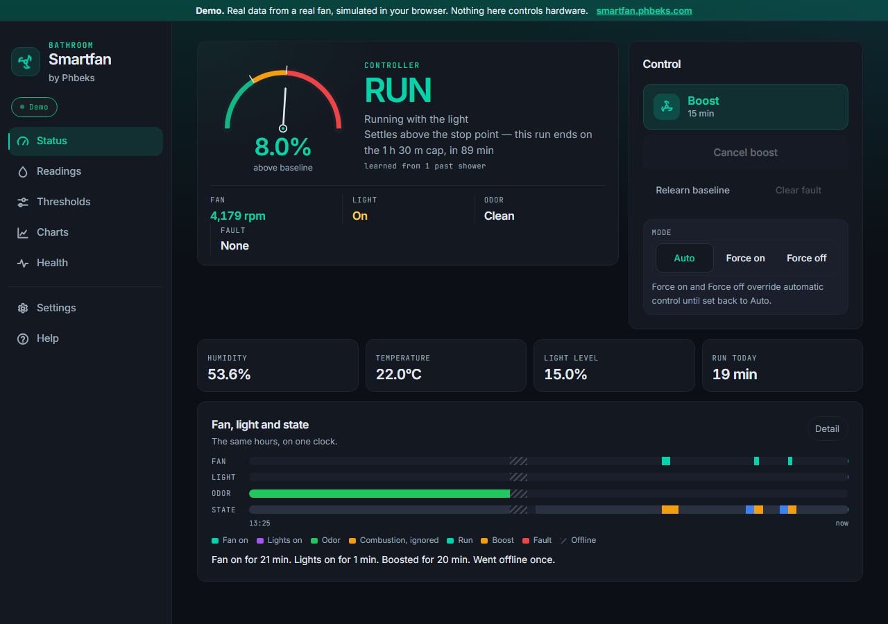
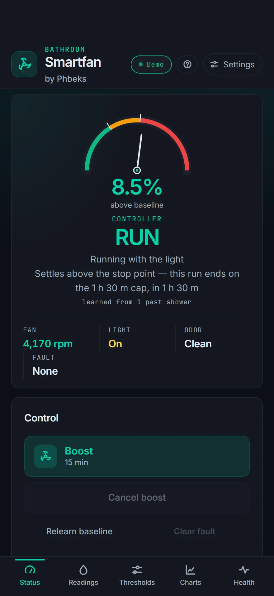
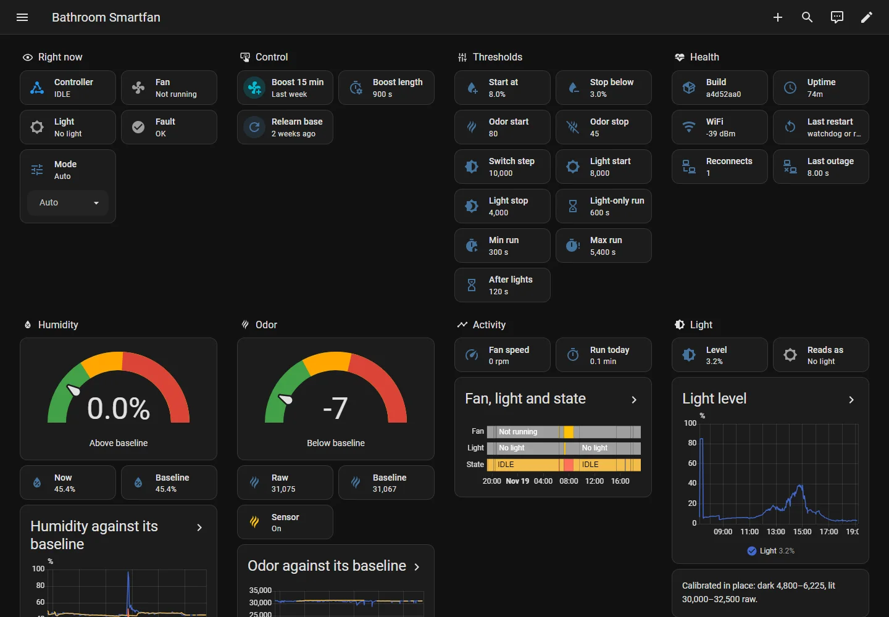
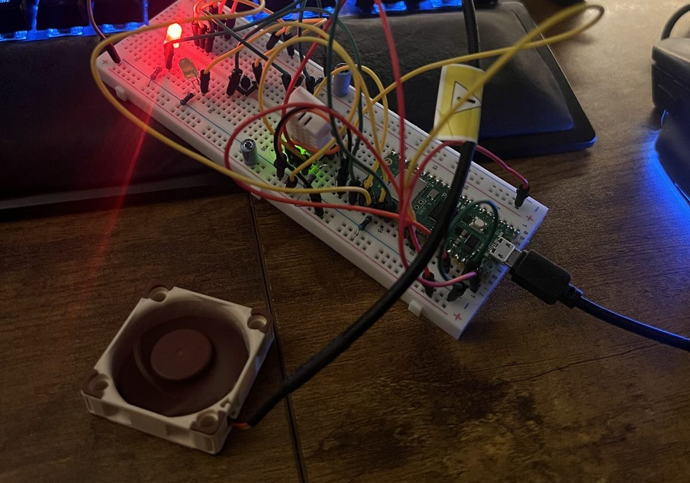
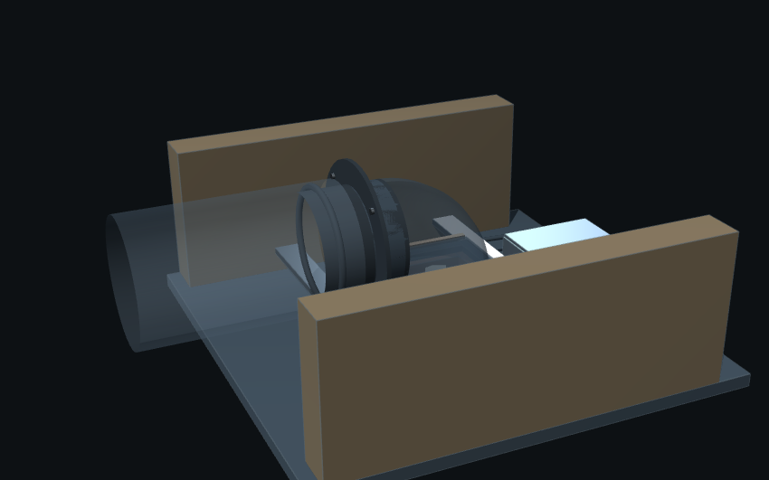

<p align="center">
  
</p>

<h1 align="center">Smartfan</h1>

<p align="center">
  <b>A bathroom fan that knows when to run.</b><br>
  It switches your extractor fan on for light, humidity and odor, runs it until the room is
  actually dry, and then stops. Open source, on a Raspberry Pi Pico 2 W.
</p>

https://github.com/user-attachments/assets/ac6792f2-4697-47a9-bf49-5d41668e7b6c

<p align="center">If the video does not play here, the same walkthrough is in the <a href="https://phbeks.com/blog/smartfan-launch.html">launch write-up</a>.</p>

<p align="center">
  <a href="https://smartfan.phbeks.com"><b>Website</b></a> ·
  <a href="https://smartfan.phbeks.com/demo/"><b>Live demo</b></a> ·
  <a href="https://smartfan.phbeks.com/kb/"><b>Docs</b></a> ·
  <a href="https://my.home-assistant.io/redirect/hacs_repository/?owner=deokman420&repository=smartfan&category=integration"><b>Add to Home Assistant</b></a>
</p>

<p align="center">
  <a href="LICENSE"></a>
  <a href="hardware/LICENSE"></a>
  <a href="https://hacs.xyz"></a>
  
  
</p>

<table>
  <tr>
    <td width="72%"></td>
    <td width="28%"></td>
  </tr>
</table>

<p align="center"><sub>The app, served by the fan itself. <a href="https://smartfan.phbeks.com/demo/">Try it in your browser</a>. The demo starts from four days of real data and simulates a fan from there.</sub></p>

---

## Why another fan controller?

Fixed thresholds don't work in a bathroom.

- **Humidity:** a muggy August day sits at 65 % RH on its own, and a fan set to
  "on above 60 %" never stops. Smartfan learns a slow **baseline** for your room
  and reacts to the **rise** above it.
- **Light:** measured in this room, direct sun reads 85 % of the sensor's range
  and the ceiling lamp 81 %. Daylight is brighter than the bulb, so no level can
  tell them apart. Speed can: the lamp moves the reading 51,511 counts in one
  2-second sample, and the sky never managed more than 51. Smartfan watches for
  that **step**, so sunlight never starts the fan.
- **Odor:** a Sensirion SGP41 reports raw counts with no absolute meaning, and
  they drift with humidity and age. Smartfan learns the room's normal air,
  corrects for humidity, and runs the fan when that changes, **even after the
  light is off**. Then it stops.

A few commercial fans sense odor too. None we found say how theirs decides when
to start or stop. Smartfan's logic is [written down](https://smartfan.phbeks.com/kb/how-it-works/)
and in this repo.

## What it does

|  |  |
|---|---|
| **Runs itself** | Light, humidity and odor start the fan. Humidity decides how long it runs. Run caps stop it running for ever, and stall detection notices a fan that isn't turning. |
| **Its own app, no cloud** | The fan serves its app from its own flash at `http://fan.local/`, with a week of history stored on the board. No account, no server, no broker required. |
| **Home Assistant** | A HACS integration, or MQTT with discovery. Every reading, threshold and control becomes an entity, with a ready-made dashboard. |
| **Signed updates over the air** | Only your build machine can update it, and a bad update rolls itself back. The recovery files only travel over USB. |
| **A button and two lights** | Boost, relearn and Wi-Fi setup all work with no app and no network. |

## In Home Assistant



Add the integration with HACS (custom repository), then add the fan by its
address, `fan.local`. Or point the fan at your MQTT broker and it appears
through discovery. Full guide: [Networking and Home Assistant](https://smartfan.phbeks.com/kb/networking/).

## The hardware

<table>
  <tr>
    <td width="50%"></td>
    <td width="50%"></td>
  </tr>
  <tr>
    <td><b>V1, the bench unit.</b> Running and commissioned in a real bathroom. 5 V USB, no mains anywhere.</td>
    <td><b>V2, the ceiling unit.</b> Designed, not built yet. <a href="https://smartfan.phbeks.com/model/">Explore it in 3D</a>.</td>
  </tr>
</table>

| V1 part | |
|---|---|
| Board | Raspberry Pi Pico 2 W (RP2350), MicroPython 1.29.0 |
| Humidity and temperature | DHT22 |
| Odor | Sensirion SGP41 (VOC and NOx), I²C |
| Light | LDR in a divider against 10 kΩ |
| Fan | Noctua NF-A4x10 5V, 3-wire with tachometer |
| Switching | S8050 NPN, low side |
| Controls | Green and red LEDs, one push button |

Parts, wiring, the pin map and the V2 board are in [Build your own](https://smartfan.phbeks.com/kb/build/).

> [!WARNING]
> **The V2 build in [`hardware/v2/`](hardware/v2/) connects to mains voltage.**
> Mains wiring can kill you and can start a fire. Build it only if you are
> competent to work on mains, keep it unplugged while it is open, and follow
> your local electrical code, which may require a licensed electrician for a
> fixed ceiling installation. The V2 board has **not been fabricated or tested
> yet**. It is a design to check, not a proven build. V1 runs on 5 V USB. This
> project comes with **no warranty** (see [License](#license)).

## Quick start (V1)

You need Python 3 with `pip install mpremote`, Node.js 20+, and a USB cable.
The examples use `COM5`; on Linux or macOS it's something like `/dev/ttyACM0`.

1. **Flash MicroPython**, the Pico 2 W ARM build from
   <https://micropython.org/download/RPI_PICO2_W/>. Hold BOOTSEL, plug in, and
   drag the `.uf2` onto the drive.
2. **Copy the firmware** in safe mode, so the controller and its 8 s watchdog
   aren't running while files land:

   ```bash
   mpremote connect COM5 fs touch :safemode + reset
   mpremote connect COM5 fs cp boot.py ota.py main.py config.py settings.py \
     telemetry.py light.py sgp41.py sht4x.py voc.py net.py mqtt.py ringbuf.py \
     calibrate.py provision.py improv.py httpd.py webapi.py store.py wifi.py :
   ```

   Don't copy `secrets.py`, `settings.json` or `identity.py` from a working
   copy. They belong to one device.
3. **Build and push the app.** This also takes the board out of safe mode:

   ```bash
   cd app && npm ci && cd ..
   python tools/build_www.py --push COM5
   ```

4. **Connect it to Wi-Fi.** With no `secrets.py` the board opens its own setup
   network. See [Set up a unit](https://smartfan.phbeks.com/kb/setup/).
5. **Calibrate the light** in the room it will live in, then optionally add it
   to Home Assistant.

After that, firmware updates go over the air. See
[Updating over the air](https://smartfan.phbeks.com/kb/ota/).

## How it works

| State | Lights | |
|---|---|---|
| LEARN | green blinking | The first 60 s, building the humidity baseline |
| IDLE | green solid | Watching, fan off |
| RUN | red solid | Fan on for light, humidity or odor |
| BOOST | red blinking | A manual 15-minute run |
| FAULT | alternating | A sensor went silent, or the fan isn't turning |

A short press of the button boosts for 15 minutes or clears a fault. Hold it
for two seconds to relearn every baseline, or eight seconds to open the Wi-Fi
setup window.

The control logic, what a real shower looks like, and the field
measurements behind each threshold are in [How it works](https://smartfan.phbeks.com/kb/how-it-works/).

## Documentation

| | |
|---|---|
| [Build your own](https://smartfan.phbeks.com/kb/build/) | Parts, wiring, pin map, first install |
| [Set up a unit](https://smartfan.phbeks.com/kb/setup/) | Wi-Fi provisioning, naming, calibration |
| [Networking and Home Assistant](https://smartfan.phbeks.com/kb/networking/) | The fan's own server, MQTT, the dashboard |
| [Updating over the air](https://smartfan.phbeks.com/kb/ota/) | Signed OTA, and why it can't brick the board |
| [How it works](https://smartfan.phbeks.com/kb/how-it-works/) | States, control logic, a real shower |
| [Odor sensing with the SGP41](https://smartfan.phbeks.com/kb/sgp41-odor-sensing/) | The signal, its sign, and settling time |
| [Daylight is brighter than the bulb](https://smartfan.phbeks.com/kb/daylight-is-brighter-than-the-bulb/) | Why light is found by its step, not its level |
| [Files in the repo](https://smartfan.phbeks.com/kb/files/) | What each file does |
| [Roadmap](https://smartfan.phbeks.com/kb/roadmap/) | The phases so far, the ceiling unit and multi-room next |

The same pages are in [`docs/`](docs/) if you'd rather read them here.

## Repository layout

| Path | What's in it |
|---|---|
| `*.py` (root) | The MicroPython firmware: control loop, sensors, Wi-Fi, HTTP API, OTA |
| [`app/`](app/) | The Svelte app the fan serves, plus the public demo build |
| [`custom_components/smartfan/`](custom_components/smartfan/) | The Home Assistant integration |
| [`hardware/`](hardware/) | V2 schematic, PCB and printed parts (build123d scripts and STLs) |
| [`tools/`](tools/) | Build, flash, OTA publishing and dashboard scripts |
| [`tests/`](tests/) | Regression suites, from host-only checks to hardware and HA |
| [`docs/`](docs/), [`site/`](site/) | The knowledge base and the website at smartfan.phbeks.com |

## Contributing

Issues and pull requests are welcome. Before opening a pull request:

- Run the host-only suites listed in [`tests/README.md`](tests/README.md). They
  need no board.
- Write in American English (color, not colour), in code, docs and UI text.
- Keep a behavior change and its doc change in the same commit. The docs live
  in this repo for that reason.

## License

- **Firmware, app, Home Assistant integration and tools:** GNU GPL v3.0. See
  [`LICENSE`](LICENSE).
- **Hardware** (everything in [`hardware/`](hardware/): schematic, PCB,
  Gerbers, CAD scripts and STLs): CERN Open Hardware Licence v2, Strongly
  Reciprocal. See [`hardware/LICENSE`](hardware/LICENSE).
- **Bundled third-party files** keep their own licenses: Inter and JetBrains
  Mono (SIL Open Font License, [`app/LICENSES/`](app/LICENSES/)) and three.js
  (MIT, [`hardware/v2/cad/vendor/LICENSE-three.txt`](hardware/v2/cad/vendor/LICENSE-three.txt)).

Both licenses come with no warranty. You build and install this at your own
risk, and that matters most for anything connected to mains.

<p align="center"><sub>Made by <a href="https://phbeks.com">phbeks.com</a></sub></p>
